<pre><picture><source media="(max-width: 1000px)" srcset="Assets/terminal/terminal-top-compact.svg" /></picture>
<a href="https://www.prasunbiswas.qzz.io/"><picture><source media="(max-width: 1000px)" srcset="Assets/terminal/terminal-link-portfolio-compact.svg" /></picture></a><a href="https://www.linkedin.com/in/prasun-kumar-biswas-789668415?utm_source=share_via&amp;utm_content=profile&amp;utm_medium=member_android"><picture><source media="(max-width: 1000px)" srcset="Assets/terminal/terminal-link-linkedin-compact.svg" /></picture></a><a href="mailto:prasun.oct27@gmail.com"><picture><source media="(max-width: 1000px)" srcset="Assets/terminal/terminal-link-email-compact.svg" /></picture></a><a href="https://github.com/prasunkumarbiswaspersonal/indian-aviation-delay-and-performance-analysis"><picture><source media="(max-width: 1000px)" srcset="Assets/terminal/terminal-link-aviation-dashboard-compact.svg" /></picture></a>
<picture><source media="(max-width: 1000px)" srcset="Assets/terminal/terminal-fetch-compact.svg" /></picture>
</pre>

---

| Metrics                                                            | Stats                                                                                                                                                                                                                           |
| :----------------------------------------------------------------- | :------------------------------------------------------------------------------------------------------------------------------------------------------------------------------------------------------------------------------- |
| <picture></picture> |   |

---

<!--

  

---
-->

  

---

  <picture>
    <source media="(max-width: 600px)" srcset="Assets/profile/toolbox-footer-mobile.svg" />
    
  </picture>

